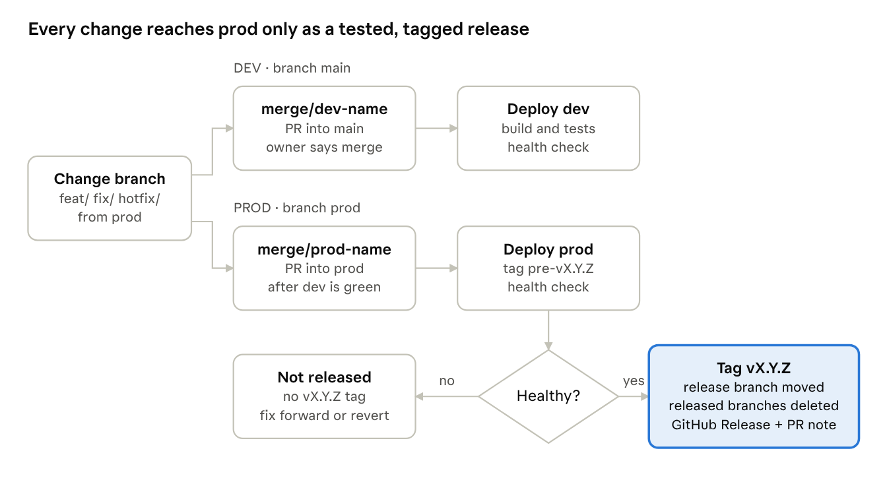

# CI/CD release playbook

One model for every project: a change branch from `prod` reaches dev and prod through its own
merge branches, every deploy ends with a health check, and every healthy prod deploy becomes a
tagged, documented release that is easy to roll back.



Only a deploy that passes its health check is tagged `vX.Y.Z` and moves `release`; the tag
`pre-vX.Y.Z` marks what was live before, so rollback is always a revert to a known commit.

| Principle | How |
|---|---|
| Prod only gets reviewed, released work | change branches start from `prod`; each stage has its own merge branch; owner says "merge" |
| No stored cloud keys | GitHub OIDC to a deploy role per AWS account, trusted only by that stage's GitHub environment |
| Every deploy is verified | a health check ends every dev and prod deploy |
| Every release is recorded | tags `pre-vX.Y.Z` and `vX.Y.Z`, branch `release`, a GitHub Release and a PR comment |
| Nothing is cleaned up by hand | `merge/` branches go on merge; released `feat/`/`fix/`/`hotfix/` branches go after release |

## Branching rules

Every change starts from `prod`, reaches each stage through its own merge branch, and only merges
when the owner says "merge".

| Branch | Created from | Who creates it | Lifetime |
|---|---|---|---|
| `main` | — | once | permanent; every merge deploys **dev** |
| `prod` | — | once | permanent; every merge deploys **production** |
| `feat/<name>`, `fix/<name>`, `hotfix/<name>` | `prod` | developer | deleted automatically once inside a release |
| `merge/dev-<name>` | `main` | developer | deleted automatically when its PR merges |
| `merge/prod-<name>` | `prod` | developer | deleted automatically when its PR merges |
| `release` | — | the release job | permanent; always points at what is live; never committed to |

Rules:

1. A change branch holds only its own change. Never merge `main`, `prod` or another change into it.
2. Dev: create `merge/dev-<name>` from `main`, merge the change branch in (resolve conflicts
   there), open a PR into `main`.
3. Prod: create `merge/prod-<name>` from `prod`, merge the change branch in (resolve conflicts
   there), open a PR into `prod`. Never PR a change branch, `main` or a `merge/dev-` branch into
   `prod`, so unreleased dev work never reaches prod.
4. Both PRs merge with a **merge commit**, dev first.
5. Nobody pushes to `main`, `prod` or `release` directly; nobody merges without the owner's "merge".
6. Another round for a stage: branch a fresh `merge/dev-<name>` or `merge/prod-<name>`.

```bash
git switch -c feat/new-page origin/prod
# work, commit, push
git switch -c merge/dev-new-page origin/main && git merge --no-ff feat/new-page
git push -u origin merge/dev-new-page     # PR -> main
git switch -c merge/prod-new-page origin/prod && git merge --no-ff feat/new-page
git push -u origin merge/prod-new-page    # PR -> prod
```

Versions are semantic: any `feat/` in a release bumps the minor number, only `fix/` or `hotfix/`
bumps the patch, and a major bump is a tag pushed by hand.

## One-time setup per project

Each project needs one AWS account per stage, a deploy role in each that trusts only its GitHub
environment, and a few repository settings; no AWS keys are ever stored in GitHub. The
`cicd-template` README has the exact commands.

**1. AWS deploy role per account (GitHub OIDC, no stored keys).** Deploy
`aws/github-deploy-role.yaml` once in each account: the dev account with `GitHubEnvironment=dev`,
the prod account with `GitHubEnvironment=production`.

- The role trusts only `repo:<Org>/<repo>:environment:<env>` **and** GitHub's ID-based subject
  `repo:<Org>@<ownerId>/<repo>@<repoId>:environment:<env>`; get the ids with
  `gh api repos/<Org>/<repo> --jq '.owner.id, .id'`.
- Add `CreateOidcProvider=false` if the account already has the
  `token.actions.githubusercontent.com` provider.
- The role may only manage stacks named `<project>*`; add permissions per service the stack uses
  (SNS, SES and so on) and redeploy the role stack before the release that needs them.
- Read the role ARN from the stack output `RoleArn` and put it in the deploy workflow for that stage.

**2. GitHub repository settings.**

| Setting | Value |
|---|---|
| Branches | create `main` and `prod` (from the same commit); default branch `main` |
| General → Pull requests | allow merge commits; **Automatically delete head branches** on |
| Environments | `dev`: deployment branches `main` only. `production`: `prod` only; required reviewers if the plan allows |
| Rules → Rulesets | `main`, `prod`, `release`: no force push, no deletion, PR required on `main`/`prod`; tags `v*`, `pre-v*`: no deletion, no update |
| Actions → General | workflow permissions read-only by default (jobs that write ask for it themselves) |

**3. Secrets and runtime settings.** Keep secrets out of GitHub where possible: runtime secrets in
each account's SSM Parameter Store (read by the stack or the deploy job), only third-party keys as
environment secrets. Per-stage values (domains, certificate ARN, addresses) are plain inputs of the
stage's deploy workflow.

## Pipeline files

Shared parts live once in **ZapsCommerce/cicd** and are called by version; each project keeps only
what is its own, starting from **ZapsCommerce/cicd-template**.

| In `ZapsCommerce/cicd` (shared) | What it does |
|---|---|
| `.github/workflows/deploy-aws-static.yml` | Reusable deploy: OIDC sign-in, `sam deploy` with every parameter written out (plain, SSM and secret), S3 upload, CloudFront invalidation; outputs `url` |
| `smoke` action | Health check: pages 200, optional CSP header, API probe, apex redirect; retries while CloudFront settles |
| `release` action | `pre`: tag `pre-vX.Y.Z`. `release`: tag `vX.Y.Z`, move `release`, delete released branches, GitHub Release + PR comment |
| `tests/test_release_script.py` | 9 tests of the release script against a throwaway git remote (run by its CI) |
| **Tag version** workflow | Creates `vX.Y.Z` and moves the major tag `vX` that projects call |

| In each project (from `cicd-template`) | Change per project |
|---|---|
| `.github/workflows/build.yml` | the test and build commands |
| `.github/workflows/deploy-dev.yml` | dev role ARN, region, stack name, parameters, pages to check |
| `.github/workflows/deploy-prod.yml` | prod role ARN, domains, certificate, parameters, pages to check |
| `aws/template.yaml` | your resources (API, headers, redirects); keep the outputs BucketName, DistributionId, SiteUrl |
| `aws/github-deploy-role.yaml` | permissions for your AWS services |
| `docs/RELEASE_CHECKLIST.md`, `CLAUDE.md` | URLs and checks; the rules stay the same |

Versions: projects in ZapsCommerce call `@v1` and get backward-compatible fixes automatically;
projects in other orgs pin `@v1.0.0` or a commit. A breaking change becomes `v2`.

Permissions in `deploy-prod.yml`: the workflow default is `contents: read` + `id-token: write`
(OIDC). Only `pre-release` and `release` get `contents: write`, and `release` also gets
`pull-requests: write` for the PR comment. The `release` action fetches every branch and tag
itself before it tags or deletes anything.

## Release flow

A release is a merged `merge/prod-<name>` PR; the pipeline does the rest, and people only check
before and after. The full checklist is `docs/RELEASE_CHECKLIST.md`.

What each prod release leaves behind:

| Ref | Meaning |
|---|---|
| tag `pre-vX.Y.Z` | the commit that was live before release X.Y.Z: the rollback point |
| tag `vX.Y.Z` | the commit that went live and passed the health check |
| branch `release` | always the live commit |
| GitHub Release `vX.Y.Z` and a comment on the prod PR | version, bump, commit, previous release, rollback point, merged branches, prod PRs |

**Before (in the prod PR):**

- [ ] Change branch from `prod`, only this change
- [ ] Tests, lint and build pass locally
- [ ] `merge/dev-<name>` merged and the dev deploy (with its health check) is green
- [ ] Checked on dev: the changed pages or features, on desktop and phone
- [ ] AWS permission or config changes applied in the prod account first
- [ ] `merge/prod-<name>` PR open, checks green, owner says "merge"

**During (automatic, watch the Deploy prod run):**

1. `pre-release` tags `pre-vX.Y.Z` at the commit live before, alongside the build.
2. Build, deploy, upload, invalidation, then the health check.
3. `release` (only if the health check passed): tags `vX.Y.Z`, moves `release`, deletes the
   released change branches, publishes the GitHub Release and the PR comment.
4. If the deploy or health check fails: no `vX.Y.Z`, `release` stays on the previous version,
   nothing is deleted.

**After:**

- [ ] GitHub Release `vX.Y.Z` lists the expected branches
- [ ] Look at the changed pages on desktop and phone (hard refresh)
- [ ] Test the critical path once (a form, a sign-in, a payment) and watch logs and alerts for an hour

**Rollback** when something is broken; fix forward when it is small:

1. `git diff pre-vX.Y.Z vX.Y.Z` shows what the release changed.
2. `fix/rollback-vX.Y.Z` from `prod`, then `git revert -m 1 <prod merge commit>` (the commit
   `vX.Y.Z` points at).
3. Ship it like any fix, dev then prod (prod first in an emergency). It becomes a new patch
   release whose code equals `pre-vX.Y.Z`; `git diff pre-vX.Y.Z prod` should print nothing.

Never redeploy an old commit by hand without reverting in git: `prod` must always match what is live.

## Lessons learned

Each of these broke a real deploy while the reference pipeline was built; the fixes are already in
the template files.

| Problem | Cause | Fix |
|---|---|---|
| First prod deploy: OIDC sign-in refused | GitHub sends an ID-based subject (`repo:Org@id/repo@id:environment:x`) for some repositories | The deploy role trusts both the name-based and the ID-based subject |
| A setting removed from the workflow stayed in AWS | `sam deploy` keeps a stack's previous parameter value when one is not passed | Write every parameter to a params file, empty ones too |
| Deploy failed after adding an AWS service | The deploy role had no rights for it (SNS, SES configuration sets) | Extend `github-deploy-role.yaml` and redeploy it in each account before the release that needs it |
| `pre-v1.1.0` tag refused | GitHub rejects a new **annotated** tag object from the workflow token when the tagged commit's workflow files differ from the default branch's | Lightweight tags only |
| Merges returned HTTP 502 and no deploy ran | GitHub accepted the merge but dropped the push event | Check the branch; if no run started, Actions → Deploy → Run workflow on that branch |
| A change branch got another stage's code | `prod` was merged into the change branch to fix a conflict | Resolve conflicts only in the `merge/` branches; change branches stay clean |
| Phone layout cut off text | A table had a desktop `min-width` | Health check catches broken pages; layout still needs a phone check before release |

Also: a Claude Code cloud session cannot delete branches or push tags (its git proxy refuses), so
branch clean-up and tags are done by the release job, not by hand.

## Adoption checklist for a new project

About half a day per project; do the steps in order and the first prod release proves the setup.

- [ ] Create `main` and `prod` from the same commit; set the default branch to `main`
- [ ] Turn on merge commits and **Automatically delete head branches**
- [ ] Create GitHub environments `dev` (branch `main`) and `production` (branch `prod`)
- [ ] Deploy `github-deploy-role.yaml` in the dev account (`GitHubEnvironment=dev`) and the prod
      account (`production`); note both role ARNs
- [ ] Start from `cicd-template` ("Use this template"); run `scripts/init-template.sh`; adapt
      `build.yml`, `aws/template.yaml` and the health-check pages
- [ ] Copy the branching and release rules (`CLAUDE.md`) into the project so people and agents follow them
- [ ] Put runtime secrets in SSM in each account
- [ ] First change through the full flow: `feat/` → `merge/dev-` → `merge/prod-`; confirm
      `pre-v1.0.0`/`v1.0.0`, the `release` branch, the GitHub Release and the PR comment
- [ ] Add rulesets for `main`, `prod`, `release` and the `v*`/`pre-v*` tags
- [ ] Keep the release checklist in the prod PR template

Shared pipeline: ZapsCommerce/cicd. Template: ZapsCommerce/cicd-template. Reference
implementation: the ZapsCommerce website repository (`.github/workflows/`, `scripts/`,
`aws/github-deploy-role.yaml`, `docs/RELEASE_CHECKLIST.md`), releases v1.0.0 to v1.2.1 on
19 November 2026.
